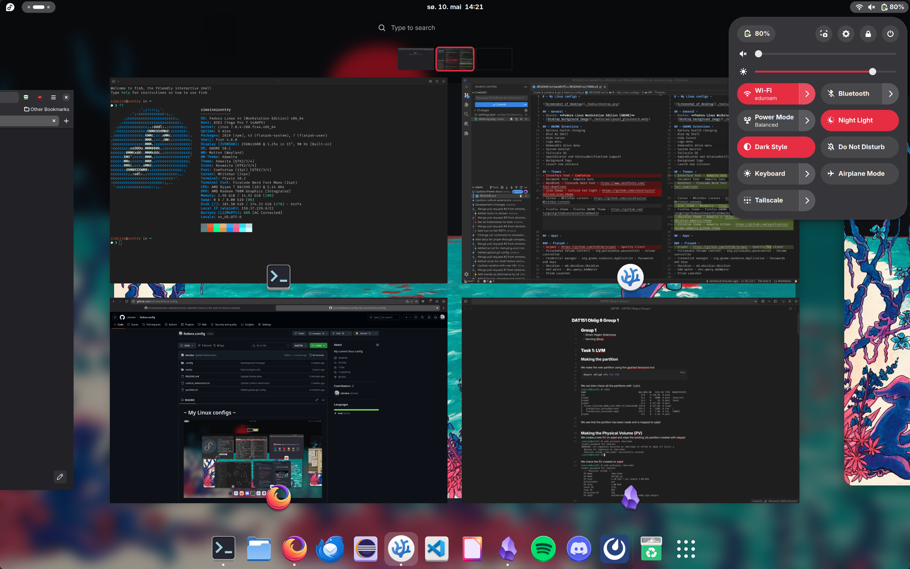

# ~ My Linux configs ~



## - General -
- Distro: **Fedora Linux Workstation Edition (GNOME)**
- [Desktop background image](./media/wallpaper_glassbeach.webp)

## - Themes -
- Interface font - Adwaita Sans
- Document font - Adwaita Sans
- NerdFont - Firacode Nerd Font Mono - https://www.nerdfonts.com/font-downloads
- Cursor - WhiteSur cursors - https://github.com/vinceliuice/WhiteSur-cursors
- Icon theme - Colloid red dark - https://github.com/vinceliuice/Colloid-icon-theme
- Obsidian theme - Adwaita z- https://github.com/birneee/obsidian-adwaita-theme
- VSCodium theme - Adwaita Github - https://github.com/egirlcatnip/vscode-adwaita-github-theme

## - GNOME Extentions -
- Blur my Shell
- Hide Cursor
- Logo menu
- Removable drive menu
- System monitor
- Tailscale QS
- Appindicator and KStatusNotifierItem Support
- Background logo
- Launch new instance

## - Apps -

### - Flatpak -
- https://github.com/hrkfdn/ncspot
- org.pulseaudio.pavucontrol
- org.gnome.seahorse.Application
- md.obsidian.Obsidian
- org.prismlauncher.PrismLauncher
- com.discordapp.Discord
- com.mattermost.Desktop
- com.mattjakeman.ExtensionManager
- com.spotify.Client
- com.usebruno.Bruno
- eu.betterbird.Betterbird
- nl.hjdskes.gcolor3
- org.gimp.GIMP
- org.gnome.Boxes
- org.libreoffice.LibreOffice
- 

### - DNF -
- qbittorrent
- starship
- fish
- VSCodium
- yt-dlp
- yt-dlp-fish-completion
- ffmpeg
- imagemagick
- fastfetch
- minicom
- smartmontools
- Mullvad vpn
- wiretuard-tools
- tailscale
- gcc
- gcc-c++
- rustup
- postgresql
- onefetch
- ncdu
- lf
- gh
- pandoc
- texlive-scheme-basic
- texlive-mdwtools
- sudo-rs
- avahi-tools
- rclone
- age
- podman
- nginx
- uv

### - Cargo - 
- zoxide (z)
- fzf
- eza
- bat
- ripgrep (rg)
- bacon
- systemctl-tui
- atuin

## Non-free packages

To enable non-free rpm-fusion packages:
```bash
sudo dnf install https://download1.rpmfusion.org/nonfree/fedora/rpmfusion-nonfree-release-$(rpm -E %fedora).noarch.rpm
```

To enable non-free ffmpeg:
```bash
sudo dnf swap ffmpeg-free ffmpeg --allowerasing
```

## Fisher

https://github.com/jorgebucaran/fisher

```sh
fisher install jorgebucaran/nvm.fish
```

## Codium

Dump codium extensions
```bash
codium --list-extensions > codium_extensions.txt
```

Install codium extensions (fish shell)
```fish
for ext in (/usr/bin/cat codium_extensions.txt); codium --install-extension $ext; end
```

## Node.js with pnpm

Install corepack

```bash
npm install --global corepack@latest
```

Enable pnpm through corepack

```bash
corepack enable pnpm
```

Update to the latest version of pnpm

```bash
corepack prepare pnpm@latest --activate
```

## Python

```bash
uv self update
```
